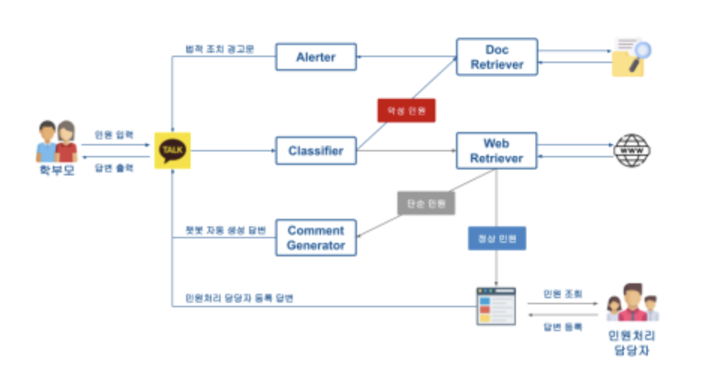
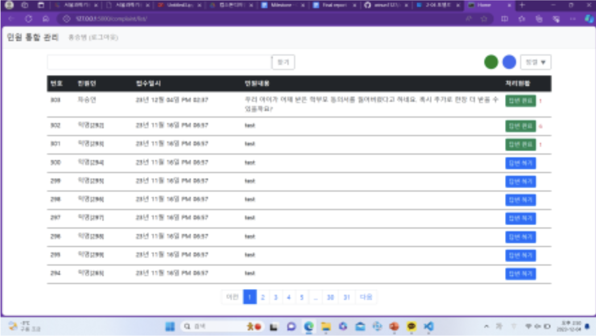
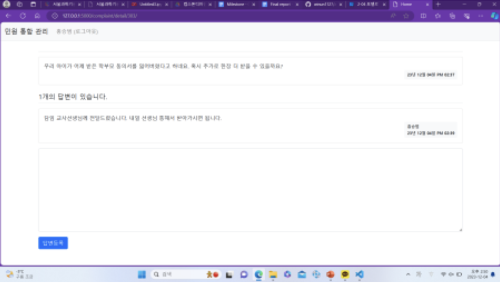
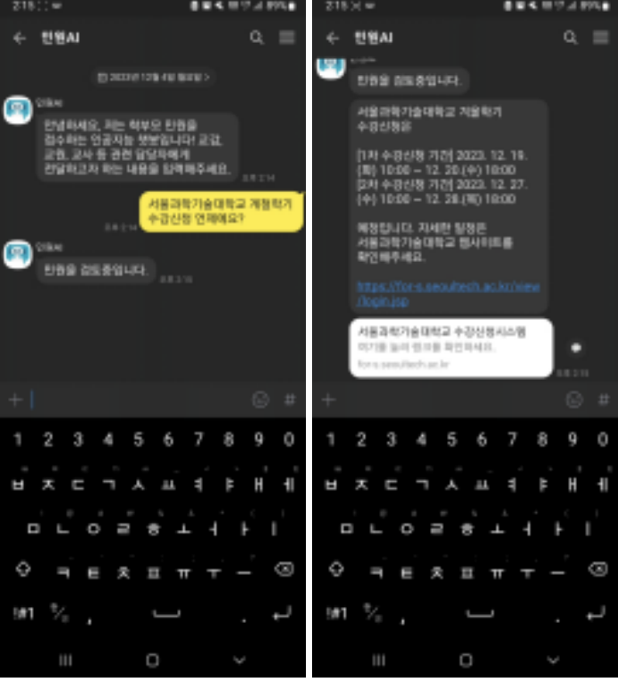

# 🏫 AI-based Parent Complaint Response Chatbot

> 서울과학기술대학교 인공지능응용학과
> Capstone Design I (2023, 2인 팀)

교사가 직접 응대해야 하는 학부모 민원의 부담을 줄이기 위해 **카카오톡 LLM 챗봇과 민원 담당자용 웹**을 개발한 프로젝트입니다.

학부모는 카카오톡으로 민원을 보내고, 챗봇이 1차로 응대하며, 담당 교사는 웹에서 민원을 조회하고 답변을 등록합니다. 악성 민원을 걸러내기 위한 LLM 분류기도 함께 실험했습니다.

---

## 📌 Project Overview

2023년 학부모의 악성 민원으로 인한 교사들의 피해가 사회적 문제가 되면서, 정부는 학교마다 교원 5명 안팎의 '민원대응팀'을 두는 방안을 내놓았습니다.

하지만 이 방식은 민원으로 인한 스트레스를 담임 교사에서 민원대응팀으로 옮길 뿐이라고 판단했습니다. 그래서 **사람이 아닌 챗봇이 1차로 민원을 받고, 사람이 꼭 답해야 하는 민원만 담당자에게 전달하는 구조**를 목표로 설계했습니다.

전체 설계는 다음과 같습니다.

- 일반 민원 → 챗봇이 자동 응대
- 악성 민원 → 분류기로 판별해 법적 조치 안내
- 챗봇이 답하기 어려운 민원 → 담당자 웹으로 전달

이 저장소에는 그중 **카카오톡 챗봇 서버, 담당자 웹, 악성 민원 분류기 실험**이 포함되어 있습니다.

---

## ✨ Features

- 📱 **카카오톡 챗봇 연동**: 카카오 i 오픈빌더 스킬 서버(`POST /api/kakao`)로 학부모 메시지를 받아 OpenAI API로 응답
- 🌐 **민원 담당자 웹**: 민원 목록, 키워드 검색, 처리 상태 필터, 날짜 정렬, 페이지네이션, 상세 조회, 답변 등록
- 🔐 **회원가입 · 로그인**: 비밀번호 해시 저장, 세션 기반 로그인, 로그인이 필요한 기능 보호
- 🗄 **DB 설계와 마이그레이션**: SQLAlchemy 모델(민원 · 답변 · 사용자)과 Flask-Migrate로 스키마 변경 관리
- 🔍 **악성 민원 분류기 실험**: LangChain few-shot 프롬프트로 악성 / 일반 민원 분류, Streamlit 테스트 화면
- 🧪 **카카오 요청 시뮬레이터**: 카카오 없이 로컬 서버에 스킬 요청을 보내 테스트

---

# 🏗 System Architecture

<p align="center">

</p>

위 그림은 팀 전체의 설계 구조도입니다. 법적 조치 안내(Alerter)는 팀원 담당 모듈로 이 저장소에 포함되어 있지 않고, 검색 기반 답변(Doc · Web Retriever)은 설계 단계에서 기획한 부분입니다.

이 저장소에 구현된 구조는 다음과 같습니다.

```
[학부모] 카카오톡
     │
     ▼
카카오 i 오픈빌더 ── POST /api/kakao ──▶ Flask 서버 ──▶ OpenAI API (GPT-3.5)
                                          │
[담당 교사] 웹 브라우저 ──────────────────▶ 담당자 웹 (Blueprint: auth · complaint · comment)
                                          │
                                          ▼
                                    SQLite (SQLAlchemy + Flask-Migrate)

[실험] assistant_test/ : LangChain few-shot 악성 민원 분류기 + Streamlit 테스트 화면
```

하나의 Flask 앱 안에서 기능별로 Blueprint를 나눴습니다.

| Blueprint | URL | 역할 |
| --- | --- | --- |
| `main` | `/` | 민원 목록으로 이동 |
| `complaint` | `/complaint/list/`, `/complaint/detail/<id>/` | 민원 목록 · 검색 · 필터 · 정렬 · 상세 |
| `comment` | `/comment/create/<id>` | 답변 등록 (로그인 필요) |
| `auth` | `/auth/signup/`, `/auth/login/`, `/auth/logout/` | 회원가입 · 로그인 |
| `api` | `/api/kakao` | 카카오 i 오픈빌더 스킬 서버 |

---

# 🖥 Service Flow

### 학부모 (카카오톡)

```
학부모가 카카오톡 채널에 메시지 입력
   │
   ▼
카카오 i 오픈빌더가 스킬 서버로 JSON 전송 (userRequest.utterance)
   │
   ▼
Flask /api/kakao → OpenAI API 호출
   │
   ▼
카카오 응답 형식(version 2.0, simpleText)으로 답변 반환
```

### 담당 교사 (웹)

```
로그인
   │
   ▼
민원 목록 (검색 · 처리 상태 필터 · 정렬 · 10개씩 페이지)
   │
   ▼
민원 상세 → 답변 등록 → 처리 완료로 표시
```

---

# 📷 User Interface

## 관리자 웹 페이지

### Home

<p align="center">

</p>

담당자가 접수된 민원을 검색 · 필터 · 정렬하며 확인하는 화면입니다.

---

### Register

<p align="center">

</p>

민원에 대한 답변을 등록하는 화면입니다.

---

## 카카오톡 챗봇

<p align="center">

</p>

학부모는 별도의 애플리케이션 설치 없이 카카오톡을 통해 민원을 보낼 수 있습니다.

---

# 🛠 Tech Stack

### Language

- Python

### Backend

- Flask (App Factory, Blueprint)
- Flask-SQLAlchemy
- Flask-Migrate (Alembic)
- Flask-WTF (WTForms)

### Database

- SQLite

### AI

- OpenAI API (GPT-3.5 Turbo)
- LangChain (few-shot prompt, output parser)
- Prompt Engineering

### Chatbot

- Kakao i Open Builder (스킬 서버)

### Tools

- Streamlit (분류기 테스트 화면)
- Azure App Service (2023년 시연 당시 배포)

---

# 📂 Project Structure

```
capstone-design-1
├── app/
│   ├── __init__.py          # create_app (App Factory), DB · 마이그레이션 · Blueprint 등록
│   ├── models.py            # Complaint, Comment, User
│   ├── forms.py             # 회원가입 · 로그인 입력 검증
│   ├── filter.py            # 날짜 표시 형식 (Jinja 필터)
│   ├── views/
│   │   ├── main_views.py
│   │   ├── complaint_views.py
│   │   ├── comment_views.py
│   │   ├── auth_views.py
│   │   └── api_views.py     # 카카오 스킬 서버
│   ├── templates/
│   └── static/
├── assistant/
│   └── chat.py              # OpenAI 챗봇
├── assistant_test/
│   ├── agent.py             # LangChain 기본 챗봇 · 악성 민원 분류기
│   ├── test.py              # Streamlit 테스트 화면
│   └── pages/
├── test/
│   ├── kakao_simulate.py    # 카카오 요청 시뮬레이터
│   └── *_body.json          # 테스트용 카카오 요청
├── migrations/              # 스키마 변경 기록 27개
├── assets/
├── config.py
└── requirements.txt
```

---

# ⚙️ Main Process

### 1. 카카오톡 민원 응대

카카오 i 오픈빌더에서 챗봇 블록에 스킬 서버 주소(`/api/kakao`)를 등록하면, 학부모가 메시지를 보낼 때마다 오픈빌더가 서버로 JSON을 보냅니다.

서버는 `userRequest.utterance`에서 메시지를 꺼내 OpenAI API로 답변을 만들고, 카카오 응답 형식으로 감싸 돌려줍니다.

```json
{"version": "2.0", "template": {"outputs": [{"simpleText": {"text": "답변"}}]}}
```

↓

### 2. 민원 조회

담당자 웹의 민원 목록은 SQLAlchemy 쿼리로 구성했습니다.

- 키워드 검색: 작성자 · 내용에 대한 부분 일치 검색 (`ilike`)
- 처리 상태 필터: 답변이 달린 민원 / 아직 없는 민원 (`comment_set.any()`)
- 정렬: 접수일 오름차순 / 내림차순
- 페이지네이션: 10개씩

↓

### 3. 답변 등록

로그인한 담당자만 답변을 등록할 수 있도록 `login_required` 데코레이터로 보호했습니다. 민원과 답변은 1:N 관계이며, 민원이 삭제되면 답변도 함께 삭제됩니다(CASCADE).

↓

### 4. 악성 민원 분류 (실험)

모델을 따로 학습시키지 않고, GPT-3.5에 판단 기준과 예시를 주는 few-shot 방식으로 분류했습니다.

- 시스템 프롬프트에 악성 민원의 정의(욕설, 인신공격, 경멸적 말투, 협박)와 판단 순서를 명시
- 실제 사례를 바탕으로 라벨을 붙인 예시 30개를 few-shot으로 제공
- 출력은 `malicious` / `non-malicious` 중 하나만 나오도록 Output Parser로 고정
- 같은 입력에 일관된 결과가 나오도록 낮은 temperature(0.1) 사용

---

# 👨‍💻 My Role

### 민원 담당자 웹 애플리케이션

- Flask App Factory · Blueprint 구조 설계
- 민원 · 답변 · 사용자 DB 모델 설계와 마이그레이션 관리
- 민원 목록(검색 · 필터 · 정렬 · 페이지네이션), 상세, 답변 등록 기능 구현
- 회원가입 · 로그인 구현 (비밀번호 해시, 세션, 로그인 필요 기능 보호)

### 악성 민원 분류기

- 악성 민원 정의와 판단 기준 설계
- LangChain Output Parser로 출력 형식 고정
- Streamlit 테스트 화면 구성

### 파이프라인 (팀원과 공동)

- 카카오 i 오픈빌더 ↔ Flask 서버 ↔ OpenAI API 연결
- 카카오 요청 시뮬레이터로 연동 테스트

---

# 💡 What I Learned

### LLM 활용

분류 결과가 기대에 못 미쳤을 때, 프롬프트 문구보다 **예시 데이터의 구성**이 결과에 더 큰 영향을 준다는 것을 확인했습니다. 어떤 예시를 어떤 비율로 보여주느냐에 따라 판단 기준 자체가 달라졌습니다.

---

### LangChain

프롬프트, 모델, 출력 파서를 하나의 체인으로 묶는 방법과 few-shot 템플릿, 대화 요약 메모리를 사용해 보며 LLM을 서비스 구성 요소로 다루는 방법을 익혔습니다.

---

### Backend

App Factory와 Blueprint로 기능을 나누고, ORM과 마이그레이션으로 DB 구조 변경을 관리하며, 세션 기반 인증을 구현하는 웹 서비스의 기본 구조를 경험했습니다.

---

### 외부 서비스 연동

카카오 i 오픈빌더가 정한 요청 · 응답 형식에 맞춰 스킬 서버를 만들면서, 외부 플랫폼과 연동할 때는 정해진 데이터 형식과 응답 시간 제한을 먼저 확인해야 한다는 것을 배웠습니다.

---

### Team Project

모듈별로 역할을 나눠 개발하면서, 모듈 사이의 연결(데이터 형식, 통합 담당)을 처음부터 정해 두는 것이 중요하다는 것을 체감했습니다.

---

# 🔧 Improvement Plan

프로젝트를 다시 검토하며 정리한 개선 방향입니다.

| 항목 | 현재 | 개선 방향 |
| --- | --- | --- |
| 대화 관리 | 챗봇 객체 하나가 모든 대화를 기록 | 카카오 사용자 ID별로 대화를 DB에 저장하고 최근 몇 턴만 전달 |
| 분류기 | 실험 코드(`assistant_test/`)로 분리 | API에 연결해 분류 결과에 따라 응답 분기 |
| 애매한 민원 | 악성으로 처리 | '판단 보류'로 분리해 담당자가 확인 (Human-in-the-Loop) |
| 분류 평가 | 테스트 문장으로 확인 | 라벨별로 균형 잡힌 평가셋으로 정확도 · 오탐률 측정 |
| 민원 저장 | 카카오 민원과 담당자 웹이 별도 | 모든 민원을 DB에 저장하고 처리 상태 컬럼으로 관리 |
| 보안 | 설정값이 코드에 포함, 가입한 사용자 모두 열람 | 비밀값 환경변수 분리, 담당자 권한, CSRF · 리다이렉트 검증 |
| 응답 시간 | 별도 처리 없음 | 카카오 응답 제한 시간에 맞춘 타임아웃과 담당자 이관 |
| 테스트 | 수동 시뮬레이터 | LLM을 대역 객체로 바꾼 자동 테스트 |

---

# 📈 Expected Effect

- 교사의 민원 응대 부담 감소
- 반복적인 일반 민원 자동 응대
- 민원 처리 현황을 한 화면에서 관리
- 악성 민원을 교사가 직접 받지 않는 구조 마련

---

# 👥 Team

| Name | Role |
|------|------|
| 홍승범 | 민원 담당자 웹 애플리케이션, 악성 민원 분류기 |
| 차승언 | LLM 테스트 모듈, 법적 조치 안내(Alerter) |
| 공동 | 카카오톡 ↔ 서버 ↔ LLM 파이프라인, 테스트 코드 |

---

# 📄 Reference

- Flask
- Flask-SQLAlchemy / Flask-Migrate
- OpenAI API
- LangChain
- Kakao i Open Builder
