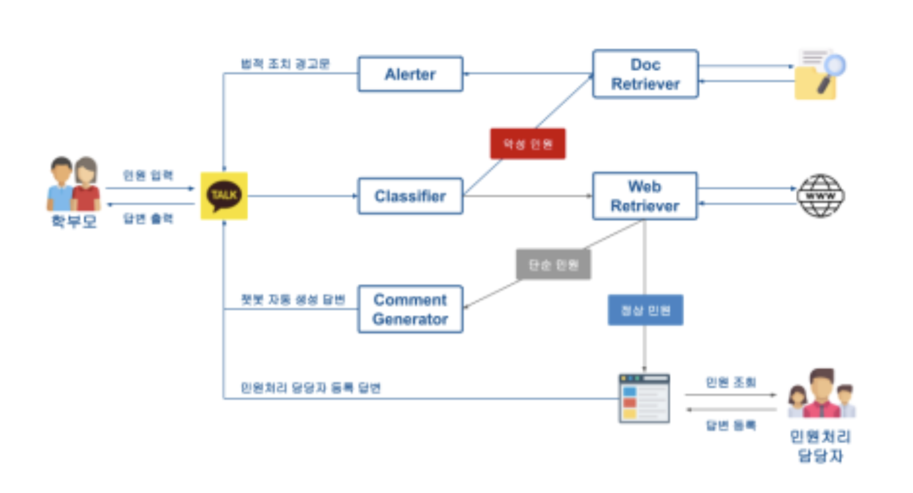
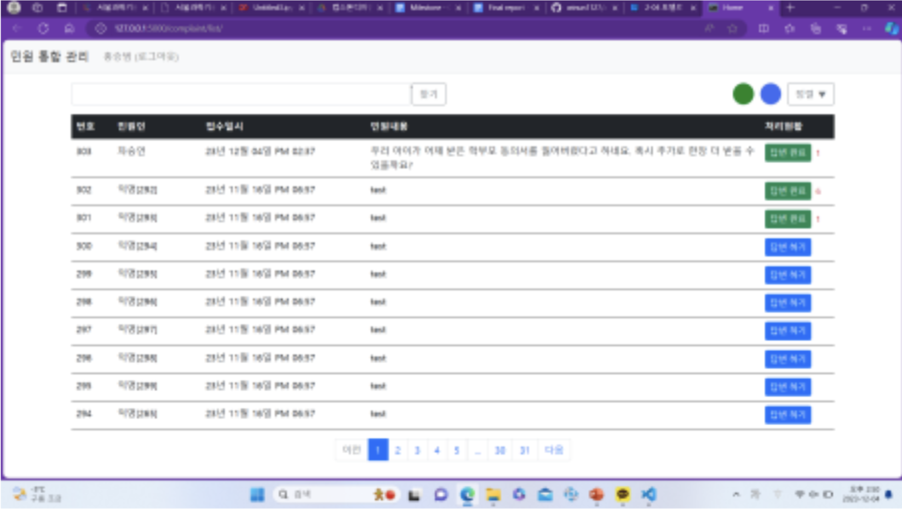
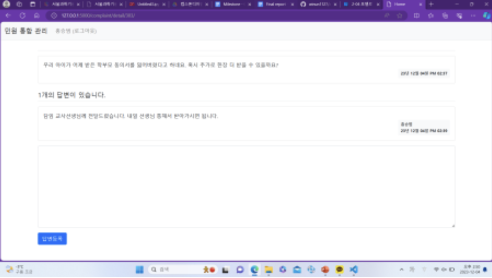
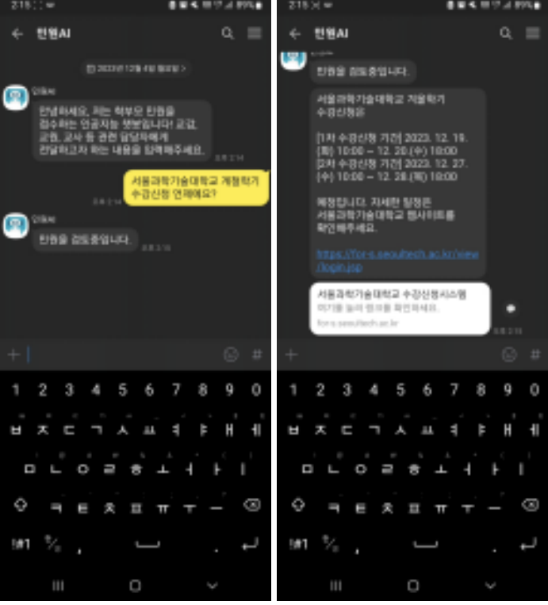

# 🏫 AI-based Parent Complaint Response Chatbot

> 서울과학기술대학교 인공지능응용학과  
> Capstone Design II (2023)

교사가 직접 응대해야 하는 학부모 민원의 부담을 줄이기 위해 **LLM 기반 민원 처리 챗봇**을 개발한 프로젝트입니다.

사용자가 입력한 민원을 AI가 분석하여 악성 여부를 분류하고, 민원 유형에 따라 자동으로 답변을 생성하거나 담당자에게 전달하는 시스템입니다.

---

## 📌 Project Overview

최근 학부모의 악성 민원으로 인해 교권 침해 문제가 사회적으로 대두되고 있습니다.

본 프로젝트는 이러한 문제를 해결하기 위해 **학부모 민원 자동 처리 시스템**을 설계하였으며,

- 악성 민원은 법적 조치 안내를 자동 생성
- 일반 민원은 AI가 답변 생성
- AI가 처리하지 못하는 민원은 담당자에게 전달

하는 전체 파이프라인을 구현하였습니다.

---

## ✨ Features

- 🔍 LLM 기반 민원 분류(Classifier)
- 💬 일반 민원 자동 답변 생성
- ⚠️ 악성 민원 법적 조치 안내 생성
- 📄 RAG 기반 문서 검색
- 🌐 웹 기반 민원 관리 시스템
- 📱 카카오톡 챗봇 연동

---

# 🏗 System Architecture

<p align="center">

</p>

프로젝트는 크게 다섯 개의 모듈로 구성됩니다.

1. 카카오톡 챗봇
2. Complaint Classifier
3. Comment Generator
4. Alerter
5. Web Application

사용자가 입력한 민원은 Classifier를 통해 분류되며, 결과에 따라 자동 응답 또는 담당자 처리 과정으로 연결됩니다.

---

# 🖥 Service Flow

```
Parent
   │
   ▼
Kakao Chatbot
   │
   ▼
Complaint Classifier
   │
   ├──────────────┐
   ▼              ▼
Malicious     Non-Malicious
   │              │
   ▼              ▼
Alerter      Web Retriever
   │              │
   ▼              ▼
Warning     AI Response
                  │
                  ▼
      No Information
                  │
                  ▼
          Admin Web Page
                  │
                  ▼
             Parent Reply
```

---

# 📷 User Interface

## 관리자 웹 페이지

### Home

<p align="center">

</p>

담당자가 접수된 민원을 확인하고 처리하는 화면입니다.

---

### Register

<p align="center">

</p>

민원에 대한 답변을 등록하는 화면입니다.

---

## 카카오톡 챗봇

<p align="center">

</p>

학부모는 별도의 애플리케이션 설치 없이 카카오톡을 통해 민원을 접수할 수 있습니다.

---

# 🛠 Tech Stack

### Language

- Python

### Backend

- Flask

### Database

- SQLite
- Azure Cosmos DB

### AI

- OpenAI API
- LangChain
- Prompt Engineering
- RAG

### Deployment

- Azure App Service

### Chatbot

- Kakao i Open Builder

---

# 📂 Project Structure

```
capstone-design-1
│
├── app.py
├── classifier.py
├── chat.py
├── templates/
├── static/
├── database/
├── utils/
└── README.md
```

---

# ⚙️ Main Process

### 1. 민원 접수

학부모가 카카오톡 챗봇을 통해 민원을 입력합니다.

↓

### 2. 민원 분류

LLM 기반 Classifier가

- 악성 민원
- 일반 민원

으로 분류합니다.

↓

### 3. 악성 민원

- 관련 법령 검색
- 법적 조치 안내 생성
- 경고 메시지 반환

↓

### 4. 일반 민원

- 웹 검색(RAG)
- 답변 생성

↓

### 5. 검색 실패

필요한 정보를 찾지 못하면

민원을 DB에 저장하고 담당자에게 전달합니다.

↓

### 6. 담당자 응답

담당자가 웹 페이지에서 답변을 등록하면

카카오톡으로 사용자에게 전달됩니다.

---

# 👨‍💻 My Role

프로젝트에서 담당한 주요 업무는 다음과 같습니다.

### 민원 처리 담당자 웹 인터페이스 구현

- Flask 기반 웹 애플리케이션 개발
- 민원 조회 및 답변 등록 기능 구현
- SQLite 및 Azure DB 연동

### 악성 민원 Classifier 구현

- OpenAI API 활용
- Prompt 설계
- 출력 형식 제어
- LangChain Output Parser 적용

### Pipeline 구현

- 챗봇 ↔ 서버
- 서버 ↔ LLM
- 서버 ↔ DB

전체 파이프라인 연결

---

# 💡 What I Learned

이번 프로젝트를 통해 단순히 LLM API를 호출하는 수준을 넘어 하나의 서비스를 설계하고 운영하는 과정을 경험할 수 있었습니다.

### LLM 활용

Prompt의 작은 변화만으로도 분류 성능과 응답 품질이 크게 달라질 수 있다는 점을 경험했습니다.

---

### LangChain

LLM을 하나의 모듈이 아닌 여러 Agent와 Pipeline으로 구성하는 방법을 익혔으며, Output Parser를 활용하여 일정한 형식의 결과를 반환하도록 구현했습니다.

---

### RAG

검색된 문서의 품질이 생성 결과에 직접적인 영향을 준다는 점을 경험했습니다.

이를 통해 Retrieval 과정이 LLM 성능만큼 중요하다는 것을 이해하게 되었습니다.

---

### Backend

Flask 기반 REST API를 구현하면서

- API 설계
- DB 연동
- 서버 구조

등 실제 서비스 개발 방식을 경험했습니다.

---

### Deployment

Azure App Service를 이용하여 서비스를 배포하면서

개발 환경과 운영 환경의 차이점을 이해할 수 있었습니다.

---

### Team Project

기능을 모듈별로 분리하여 협업하는 과정을 경험했으며,

Git을 활용한 버전 관리와 역할 분담의 중요성을 체감했습니다.

---

# 🚧 Limitations

- 학습 데이터 부족
- 민원 종류 다양성 부족
- 검색 정확도 개선 필요
- Classifier 성능 개선 필요
- Prompt 최적화 필요

---

# 🚀 Future Work

- Fine-Tuning 적용
- Vector Database 개선
- 검색 성능 향상
- 민원 데이터셋 확장
- 관리자 UI 개선
- 대화 이력 관리 기능 추가
- 사용자 인증 기능 추가

---

# 📈 Expected Effect

- 교사의 민원 응대 부담 감소
- 악성 민원 자동 대응
- 반복적인 민원 자동 처리
- 민원 처리 시간 단축
- 업무 효율 향상

---

# 👥 Team

| Name | Role |
|------|------|
| 홍승범 | Web Application, Complaint Classifier |
| 차승언 | LLM Module, Alerter |

---

# 📄 Reference

- OpenAI API
- LangChain
- Flask
- Azure App Service
- Azure Cosmos DB
- Kakao i Open Builder
